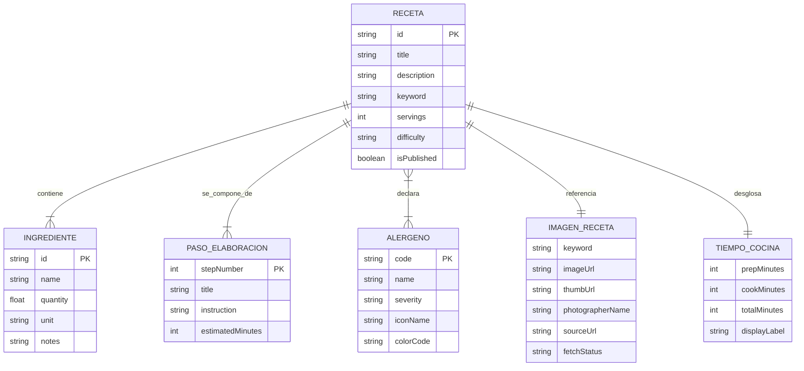
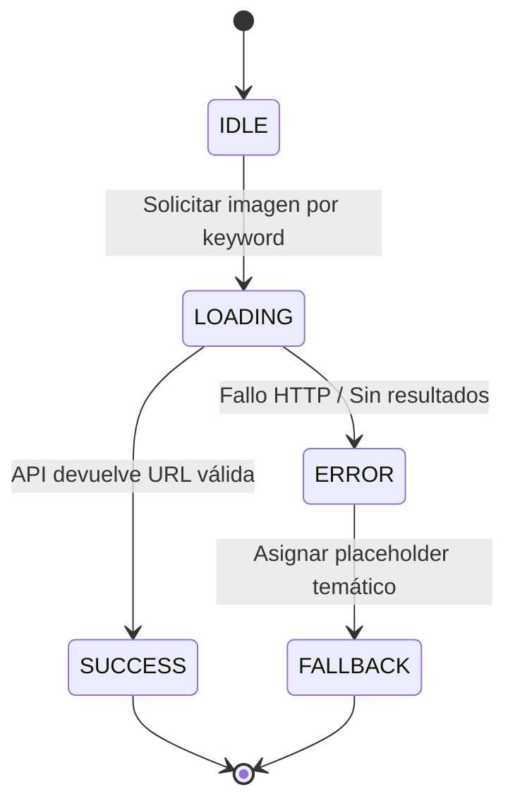

# Data Model: Catálogo Profesional de Recetas

**Feature**: `001-recipe-catalog`  
**Status**: Completed  
**Date**: 2026-10-13  

---

## 1. Diagrama de Entidades y Relaciones

---

## 2. Definición Detallada de Entidades

### 2.1. Entidad: `Receta` (`Recipe`)
Representa el plato gastronómico principal y su ficha documental.

| Campo | Tipo | Obligatorio | Descripción / Reglas de Validación |
| :--- | :--- | :---: | :--- |
| `id` | `string` (UUID o slug) | Sí | Identificador único de la receta (ej. `rec-paella-valenciana`). |
| `title` | `string` | Sí | Nombre del plato culinario. Longitud: 3 a 100 caracteres. |
| `description` | `string` | Sí | Reseña o sinopsis atractiva del plato. Máximo 300 caracteres. |
| `keyword` | `string` | Sí | Palabra clave gastronómica utilizada para recuperar la imagen vía API. |
| `servings` | `number` | Sí | Número de porciones (entero positivo $\ge 1$). |
| `difficulty` | `enum` | Sí | Nivel de destreza: `'Fácil'`, `'Intermedio'`, `'Avanzado'`. |
| `cookingTime` | `CookingTime` | Sí | Objeto con el desglose de tiempos de preparación y cocción. |
| `ingredients` | `Ingredient[]` | Sí | Lista de al menos 1 ingrediente registrado. |
| `steps` | `RecipeStep[]` | Sí | Secuencia ordenada de pasos de preparación ($\ge 1$). |
| `allergens` | `AllergenType[]` | Sí | Lista de códigos de alérgenos presentes. Si está vacía, representa plato seguro. |
| `image` | `RecipeImage` | Opcional | Datos y estado de la imagen asociada recuperada por keyword. |

### 2.2. Entidad: `TiempoCocina` (`CookingTime`)
Estructura que modela la duración de las fases de elaboración de la receta.

| Campo | Tipo | Obligatorio | Regla de Validación |
| :--- | :--- | :---: | :--- |
| `prepMinutes` | `number` | Sí | Minutos de preparación previa (lavado, corte, pesado). Entero $\ge 0$. |
| `cookMinutes` | `number` | Sí | Minutos de cocción térmica activa. Entero $\ge 0$ (0 indica plato frío/sin cocción). |
| `totalMinutes` | `number` | Sí | Calculado automáticamente: `prepMinutes + cookMinutes`. |
| `displayLabel` | `string` | Sí | Etiqueta formateada (ej. `"45 min"`, `"1 h 15 min"` o `"Sin cocción térmica"`). |

### 2.3. Entidad: `Ingrediente` (`Ingredient`)
Detalle cuantitativo y cualitativo de cada elemento necesario para la receta.

| Campo | Tipo | Obligatorio | Regla de Validación |
| :--- | :--- | :---: | :--- |
| `id` | `string` | Sí | Identificador único dentro de la receta. |
| `name` | `string` | Sí | Nombre del ingrediente (ej. "Arroz bomba", "Aceite de oliva virgen extra"). |
| `quantity` | `number` | Sí | Cantidad numérica $> 0$. |
| `unit` | `string` | Sí | Unidad normalizada (ej. `"g"`, `"ml"`, `"cda"`, `"unidad"`, `"al gusto"`). |
| `notes` | `string` | No | Observaciones (ej. "a temperatura ambiente", "cortado en brunoise"). |

### 2.4. Entidad: `Alérgeno` (`Allergen`)
Categorización médica estandarizada según normativa europea (14 alérgenos).

| Código (`code`) | Nombre Común | Color Distintivo | Ícono Sugerido |
| :--- | :--- | :--- | :--- |
| `GLUTEN` | Cereales con gluten | `#E5A93C` (Ámbar dorado) | Espiga de trigo |
| `CRUSTACEANS` | Crustáceos | `#E05D44` (Rojo coral) | Cangrejo / Gamba |
| `EGGS` | Huevos | `#F4C430` (Amarillo yema) | Huevo |
| `FISH` | Pescado | `#3B82F6` (Azul océano) | Pescado |
| `PEANUTS` | Cacahuetes | `#B45309` (Marrón tierra) | Cacahuete |
| `SOY` | Soja | `#10B981` (Verde hoja) | Vaina de soja |
| `DAIRY` | Lácteos | `#60A5FA` (Azul cielo lechoso) | Botella de leche |
| `NUTS` | Frutos de cáscara | `#78350F` (Nogal oscuro) | Nuez / Avellana |
| `CELERY` | Apio | `#84CC16` (Verde lima) | Tallo de apio |
| `MUSTARD` | Mostaza | `#D97706` (Mostaza brillante) | Semilla / Flor |
| `SESAME` | Sésamo | `#D1D5DB` (Gris perlado) | Semilla de sésamo |
| `SULPHITES` | Sulfitos / SO2 | `#8B5CF6` (Púrpura) | Copa de vino |
| `LUPIN` | Altramuces | `#FBBF24` (Amarillo solar) | Flor de altramuz |
| `MOLLUSCS` | Moluscos | `#06B6D4` (Cian marino) | Concha marina |

### 2.5. Entidad: `ImagenReceta` (`RecipeImage`)
Estado y metadatos de la imagen descargada mediante la API externa de imágenes.

| Campo | Tipo | Obligatorio | Reglas y Estados |
| :--- | :--- | :---: | :--- |
| `keyword` | `string` | Sí | Término con el que se consultó la API. |
| `imageUrl` | `string` | No | URL pública directa de la imagen en alta definición. |
| `thumbUrl` | `string` | No | URL de miniatura para vistas previas en tarjetas. |
| `photographerName`| `string` | No | Nombre del autor para atribución fotográfica ética. |
| `sourceUrl` | `string` | No | Enlace de origen del servicio de fotografía. |
| `fetchStatus` | `enum` | Sí | `'IDLE' \| 'LOADING' \| 'SUCCESS' \| 'ERROR' \| 'FALLBACK'`. |

### 2.6. Entidad: `PlanSemanal` (`WeeklyPlan`)
Estructura de planificación organizada para los 7 días de la semana.

| Campo | Tipo | Obligatorio | Regla de Validación |
| :--- | :--- | :---: | :--- |
| `id` | `string` | Sí | Identificador del plan semanal (ej. `plan-current`). |
| `days` | `Record<DayOfWeek, DayPlan>` | Sí | Mapa de 7 días: `'lunes'`, `'martes'`, `'miercoles'`, `'jueves'`, `'viernes'`, `'sabado'`, `'domingo'`. |
| `updatedAt` | `number` | Sí | Marca temporal de última modificación. |

### 2.7. Entidad: `PlanDiario` (`DayPlan`)
Turnos de comida asignables a un día de la semana.

| Campo | Tipo | Obligatorio | Regla de Validación |
| :--- | :--- | :---: | :--- |
| `lunch` | `Recipe \| null` | No | Receta asignada para el almuerzo/comida principal del día. |
| `dinner` | `Recipe \| null` | No | Receta asignada para la cena del día. |

### 2.8. Entidad: `ItemListaCompra` (`ShoppingListItem`)
Elemento consolidado en la lista de la compra calculada a partir del plan semanal.

| Campo | Tipo | Obligatorio | Regla de Validación |
| :--- | :--- | :---: | :--- |
| `key` | `string` | Sí | Clave única normalizada (ej. `arroz bomba_g`). |
| `name` | `string` | Sí | Nombre del ingrediente normalizado. |
| `totalQuantity` | `number` | Sí | Suma acumulada de cantidades para la misma unidad ($> 0$). |
| `unit` | `string` | Sí | Unidad de medida homogénea. |
| `sourceRecipes` | `string[]` | Sí | Nombres de las recetas del plan que requieren este ingrediente. |
| `checked` | `boolean` | Sí | Estado interactivo de compra (tachado/comprado). |

---

## 3. Máquina de Estados: Ciclo de Carga de Imagen por Keyword

---

## 4. Reglas de Validación e Integridad

1. **Integridad de Tiempos**: `totalMinutes` DEBE ser igual a `prepMinutes + cookMinutes`. Si ambos son 0, la receta se clasifica como *preparación inmediata*.
2. **Declaración Explícita de Alérgenos**: Un array de alérgenos vacío (`allergens = []`) obliga a la interfaz a mostrar el badge de seguridad `"Libre de alérgenos comunes declarados"`.
3. **Respaldo de Imagen Obligatorio**: Si `fetchStatus === 'ERROR'`, la aplicación DEBE transicionar automáticamente a `'FALLBACK'` inyectando la imagen de reserva sin interrumpir la visualización del resto de la ficha.
4. **Validación de Ingredientes**: Cada ingrediente debe contar con nombre y cantidad positiva.
5. **Consolidación Aritmética de la Compra**: Los ingredientes con mismo nombre (ignorado mayúsculas/minúsculas) y misma unidad DEBEN agruparse sumando sus cantidades numéricas. Si difieren en unidad, deben representarse en ítems separados para no falsear cantidades.
6. **Persistencia Local**: Tanto el `WeeklyPlan` como el estado `checked` de la lista de la compra deben persistir reactivamente en el almacenamiento del navegador.

