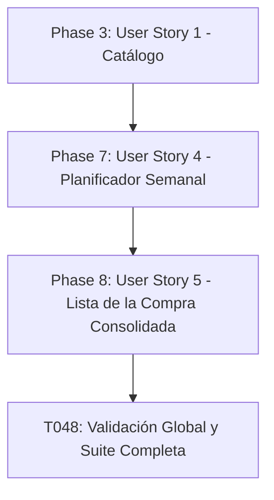

# Tasks: Catálogo Profesional de Recetas con React 19

**Feature**: `001-recipe-catalog`  
**Spec**: [spec.md](spec.md) | **Plan**: [plan.md](plan.md)  
**Status**: Implementation Completed  
**Created**: 2026-10-13  

---

## Phase 1: Setup (Shared Infrastructure)

**Purpose**: Inicialización del proyecto, configuración de dependencias y herramientas de desarrollo para React 19.

- [X] T001 Crear estructura de directorios del proyecto frontend según el plan de arquitectura en `src/domain/`, `src/infrastructure/`, `src/presentation/` y `src/tests/`
- [X] T002 Inicializar dependencias en `package.json` con React 19 (`react@^19.0.0`, `react-dom@^19.0.0`), Vite 6, TypeScript 5 y plugins visuales (`lucide-react`, `clsx`, `tailwind-merge`)
- [X] T003 [P] Configurar compilador TypeScript con modo estricto y alias de rutas en `tsconfig.json`
- [X] T004 [P] Configurar entorno de pruebas unitarias y de integración con Vitest, React Testing Library y MSW en `vitest.config.ts` y `src/tests/setup.ts`
- [X] T005 [P] Configurar tokens de diseño visual profesional (paleta cromática gastronómica, tipografía y sombras) en `src/presentation/styles/theme.css`

---

## Phase 2: Foundational (Blocking Prerequisites)

**Purpose**: Modelos de datos del dominio, contratos e infraestructura base indispensables antes de implementar cualquier historia de usuario.

**[CRITICAL]**: No debe iniciarse el trabajo en ninguna historia de usuario hasta completar esta fase.

- [X] T006 [P] Definir tipos e identificadores normalizados para los 14 alérgenos de la normativa europea (`GLUTEN`, `CRUSTACEANS`, `EGGS`, `FISH`, `PEANUTS`, `SOY`, `DAIRY`, `NUTS`, `CELERY`, `MUSTARD`, `SESAME`, `SULPHITES`, `LUPIN`, `MOLLUSCS`) en `src/domain/models/allergen.types.ts`
- [X] T007 [P] Crear modelos de datos para tiempos culinarios e ingredientes con validación de `prepMinutes >= 0`, `cookMinutes >= 0`, `totalMinutes = prepMinutes + cookMinutes` y `quantity > 0` en `src/domain/models/cooking_time.ts` y `src/domain/models/ingredient.ts`
- [X] T008 [P] Crear modelo principal de Receta con restricciones (`servings >= 1`, dificultad `'Fácil' | 'Intermedio' | 'Avanzado'`, y título de 3 a 100 caracteres) en `src/domain/models/recipe.ts`
- [X] T009 [P] Crear semilla de datos estructurada con recetas preconfiguradas con ingredientes, alérgenos y palabras clave gastronómicas en `src/infrastructure/data/recipes.seed.json`
- [X] T010 Implementar servicio base `RecipeService` que consuma el catálogo de recetas conforme a la interfaz `IRecipeService` en `src/infrastructure/services/recipe_service.ts`

**Checkpoint**: Base del dominio e infraestructura completada. Las historias de usuario pueden comenzar a desarrollarse.

---

## Phase 3: User Story 1 - Exploración y Consulta Detallada de Recetas (Priority: P1) [MVP]

**Goal**: Permitir al usuario explorar la lista de recetas y visualizar la ficha completa con ingredientes (cantidades/unidades), pasos de preparación, tiempos desglosados (preparación vs. cocción) y advertencias destacadas de alérgenos.

**Independent Test**: Cargar la aplicación, seleccionar una receta del catálogo y verificar que se despliega la ficha íntegra con ingredientes, tiempos y alérgenos de forma legible y sin fallos.

### Tests for User Story 1 (TDD Mandatorio)

- [X] T011 [P] [US1] Crear prueba de contrato para `RecipeService.getRecipes()` y `RecipeService.getRecipeById()` en `src/tests/contract/recipe_service.test.ts`
- [X] T012 [P] [US1] Crear pruebas unitarias para el cálculo de tiempo total culinario y validación de ingredientes en `src/tests/unit/cooking_time.test.ts`

### Implementation for User Story 1

- [X] T013 [P] [US1] Implementar componente accesible `AllergenBadge` con colores normalizados y etiqueta explícita "Libre de alérgenos comunes declarados" cuando aplique en `src/presentation/components/AllergenBadge.tsx`
- [X] T014 [P] [US1] Implementar componente `CookingTimeBadge` con icono y desglose de tiempos de preparación y cocción en `src/presentation/components/CookingTimeBadge.tsx`
- [X] T015 [US1] Implementar componente de tarjeta de receta `RecipeCard` mostrando título, porciones, dificultad, tiempos y badges de alérgenos en `src/presentation/components/RecipeCard.tsx`
- [X] T016 [US1] Implementar vista de ficha en profundidad `RecipeDetail` con desglose de ingredientes estructurados, pasos numerados y advertencias de seguridad en `src/presentation/components/RecipeDetail.tsx`
- [X] T017 [US1] Integrar el catálogo interactivo y la navegación entre vista de lista y detalle de receta en `src/presentation/App.tsx`
- [X] T018 [US1] Crear prueba de integración de componentes para la apertura y lectura completa de una receta en `src/tests/components/RecipeDetail.test.tsx`

**Checkpoint**: En este punto, la Historia de Usuario 1 constituye un Producto Mínimo Viable (MVP) completamente operativo y verificable de forma independiente.

---

## Phase 4: User Story 2 - Experiencia Visual Profesional con Imágenes Dinámicas por Palabra Clave (Priority: P2)

**Goal**: Cargar dinámicamente imágenes gastronómicas de alta calidad consultando un servicio externo mediante la palabra clave de cada receta, con estados de carga (*skeleton loaders*) y reemplazo automático por imagen de respaldo (*fallback*) ante errores.

**Independent Test**: Configurar recetas con diversas palabras clave y verificar que se solicitan las imágenes, se exhiben indicadores esqueléticos de carga y, ante fallos de red o errores 429, se muestra una ilustración culinaria de respaldo sin que la aplicación falle.

### Tests for User Story 2 (TDD Mandatorio)

- [X] T019 [P] [US2] Crear pruebas de contrato con MSW para el cliente de imágenes simulando respuesta HTTP 200 OK, respuesta vacía, fallo de red y error HTTP 429 en `src/tests/contract/image_provider.test.ts`

### Implementation for User Story 2

- [X] T020 [P] [US2] Implementar gestor de caché de imágenes indexado por palabra clave en memoria / sessionStorage en `src/infrastructure/cache/image_cache.ts`
- [X] T021 [US2] Implementar adaptador `ImageProviderClient` según el contrato `IImageProvider` con fallback a SVG temático gastronómico cuando `fetchStatus === 'ERROR'` en `src/infrastructure/api/image_provider_client.ts`
- [X] T022 [P] [US2] Implementar componente `SkeletonCard` con animación visual de pulso para la carga progresiva de imágenes y textos en `src/presentation/components/SkeletonCard.tsx`
- [X] T023 [US2] Implementar hook reactivo `useRecipeImage` con React 19 `useTransition` para gestionar estados `IDLE`, `LOADING`, `SUCCESS`, `ERROR` y `FALLBACK` en `src/presentation/hooks/useRecipeImage.ts`
- [X] T024 [US2] Integrar la carga de imágenes asíncronas con atribución ética del fotógrafo y fallback visual en `src/presentation/components/RecipeCard.tsx` y `src/presentation/components/RecipeDetail.tsx`
- [X] T025 [US2] Crear prueba de componente que verifique la transición inmediata a imagen de reserva ante fallo de la API externa en `src/tests/components/RecipeImageFallback.test.tsx`

**Checkpoint**: Historias de Usuario 1 y 2 plenamente operativas y desacopladas; la interfaz exhibe un acabado visual profesional con fotografías dinámicas y resiliencia ante contingencias.

---

## Phase 5: User Story 3 - Filtrado y Búsqueda por Alérgenos e Ingredientes (Priority: P3)

**Goal**: Permitir la búsqueda de recetas en tiempo real y la exclusión de recetas que contengan alérgenos seleccionados para garantizar una experiencia personalizada y segura.

**Independent Test**: Aplicar el filtro de exclusión para "Gluten" o "Lácteos" y comprobar que las recetas con dichos alérgenos desaparecen instantáneamente del catálogo mientras que las recetas libres de ellos permanecen visibles.

### Tests for User Story 3 (TDD Mandatorio)

- [X] T026 [P] [US3] Crear pruebas unitarias para el motor de filtrado por alérgenos excluidos (`excludedAllergens`) y coincidencia de ingredientes en `src/tests/unit/recipe_filter.test.ts`

### Implementation for User Story 3

- [X] T027 [US3] Extender `RecipeService` para admitir parámetros de filtrado `RecipeFilterOptions` (búsqueda por texto, alérgenos excluidos y tiempo máximo de cocción) en `src/infrastructure/services/recipe_service.ts`
- [X] T028 [P] [US3] Implementar componente interactivo `SearchFilters` con barra de búsqueda, selector múltiple de alérgenos a excluir y filtros de tiempo en `src/presentation/components/SearchFilters.tsx`
- [X] T029 [US3] Conectar el estado de búsqueda y filtros reactivos en `App.tsx` con manejo de estado sin resultados coincidentes en `src/presentation/App.tsx`
- [X] T030 [US3] Crear prueba de integración que valide la exclusión correcta de platos con alérgenos específicos en la vista principal en `src/tests/components/SearchFilters.test.tsx`

**Checkpoint**: Las tres historias de usuario se encuentran completas, probadas y funcionales.

---

## Phase 6: Polish & Cross-Cutting Concerns

**Purpose**: Aseguramiento de calidad, accesibilidad, diseño responsivo y verificación global.

- [X] T031 [P] Ajustar diseño responsivo comprobando adaptabilidad desde dispositivos móviles (360px) hasta pantallas 4K en `src/presentation/styles/responsive.css`
- [X] T032 [P] Realizar auditoría de accesibilidad WCAG (roles ARIA, contraste cromático de badges y texto alternativo en imágenes) en `src/presentation/components/AllergenBadge.tsx` y `src/presentation/components/RecipeCard.tsx`
- [X] T033 [P] Optimizar rendimiento de renderizado y transiciones fluidas de React 19 en `src/presentation/App.tsx`
- [X] T034 Ejecutar validación completa de escenarios de extremo a extremo conforme a la guía documental en `specs/001-recipe-catalog/quickstart.md`

---

## Phase 7: User Story 4 - Planificación de Menú Semanal (Priority: P2)

**Goal**: Permitir al usuario organizar sus comidas semanales asignando recetas a los 7 días (Lunes a Domingo) para comida y cena, con persistencia en localStorage.

**Independent Test**: Asignar recetas a diferentes días del menú semanal, recargar la página y verificar que las asignaciones persisten y pueden sustituirse o removerse de forma interactiva.

### Tests for User Story 4 (TDD Mandatorio)

- [X] T035 [P] [US4] Crear pruebas unitarias para la inicialización, asignación, eliminación y persistencia del plan semanal en `src/tests/unit/planner_service.test.ts`

### Implementation for User Story 4

- [X] T036 [P] [US4] Definir tipos del planificador semanal (`DayOfWeek`, `MealSlot`, `DayPlan`, `WeeklyPlan`) en `src/domain/models/planner.types.ts`
- [X] T037 [US4] Implementar servicio `PlannerService` con gestión de estado en memoria y persistencia reactiva en `localStorage` en `src/infrastructure/services/planner_service.ts`
- [X] T038 [P] [US4] Implementar modal accesible de selección de recetas `RecipeSelectModal` con filtro de búsqueda rápida en `src/presentation/components/RecipeSelectModal.tsx`
- [X] T039 [US4] Implementar cuadrícula interactiva de 7 días x 2 turnos `WeeklyPlanner` con botones de asignar y retirar comida en `src/presentation/components/WeeklyPlanner.tsx`
- [X] T040 [US4] Integrar pestaña de navegación "Plan Semanal" y selector en `src/presentation/App.tsx`
- [X] T041 [US4] Crear prueba de integración de componentes para la asignación y visualización del menú en `src/tests/components/WeeklyPlanner.test.tsx`

---

## Phase 8: User Story 5 - Generación y Consolidación de Lista de la Compra (Priority: P2)

**Goal**: Generar automáticamente una lista de la compra agregada a partir de los ingredientes de las recetas del plan semanal, consolidando aritméticamente ingredientes duplicados con misma unidad, casillas de verificación interactivas y copia al portapapeles.

**Independent Test**: Configurar recetas con ingredientes compartidos en el plan semanal y verificar que la lista de la compra suma sus cantidades en una sola fila consolidada y permite marcar ítems como comprados.

### Tests for User Story 5 (TDD Mandatorio)

- [X] T042 [P] [US5] Crear pruebas unitarias para el algoritmo de consolidación aritmética de ingredientes y formateo a texto plano en `src/tests/unit/shopping_list_service.test.ts`

### Implementation for User Story 5

- [X] T043 [P] [US5] Definir modelo y tipos de datos para ítems de compra consolidados (`ShoppingListItem`) en `src/domain/models/shopping_list.types.ts`
- [X] T044 [US5] Implementar servicio de consolidación `ShoppingListService` agrupando por clave normalizada (nombre + unidad) y sumando cantidades numéricas en `src/infrastructure/services/shopping_list_service.ts`
- [X] T045 [P] [US5] Implementar vista de lista de la compra `ShoppingListView` con casillas interactivas, indicador de recetas de origen y botón de copiado en `src/presentation/components/ShoppingListView.tsx`
- [X] T046 [US5] Conectar la generación reactiva de la lista de la compra y pestaña "Lista de la Compra" en `src/presentation/App.tsx`
- [X] T047 [US5] Crear prueba de componente para la interacción de marcado de ítems comprados y exportación a texto en `src/tests/components/ShoppingListView.test.tsx`
- [X] T048 Validar escenarios completos de menú semanal y lista de la compra asegurando cero errores de compilación y pruebas automatizadas al 100%

---

## Dependencies & Execution Order

### Phase Dependencies

- **Phases 1 a 6**: Completadas y verificadas.
- **User Story 4 (Phase 7 - P2)**: Depende de Phase 2 (Foundational) y Phase 3 (US1).
- **User Story 5 (Phase 8 - P2)**: Depende de Phase 7 (US4), ya que la lista de la compra se deriva de las recetas del plan semanal.

### User Story Dependencies

### Parallel Opportunities

- **Fase 7**: T035 (pruebas) y T036 (tipos de planner) en paralelo; T038 (modal) en paralelo con T037 (servicio).
- **Fase 8**: T042 (pruebas) y T043 (tipos) en paralelo; T045 (vista) en paralelo con T044 (servicio).

