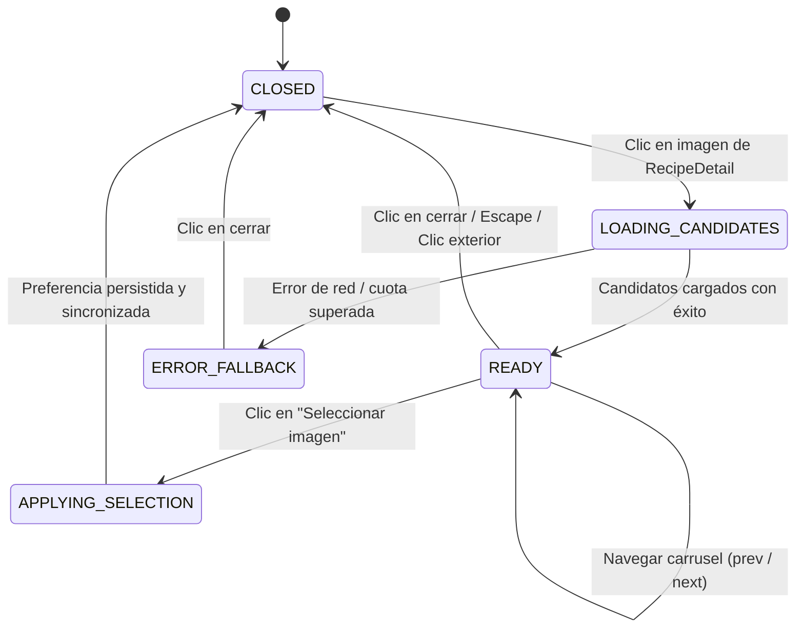
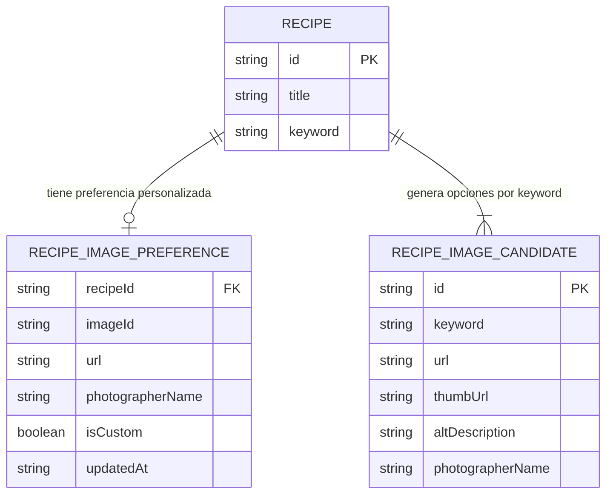

# Data Model: Selección de Imagen Alternativa para Recetas mediante Carrusel

**Feature**: `002-load-image`  
**Date**: 2026-10-14  

---

## 1. Entidades Principales

### 1.1. `RecipeImageCandidate` (Candidato de Imagen)
Representa una alternativa gráfica obtenida del proveedor de imágenes a partir de las palabras clave de la receta.

```typescript
export interface RecipeImageCandidate {
  id: string;                     // Identificador único de la imagen
  keyword: string;                // Palabra clave asociada a la búsqueda
  url: string;                    // URL de alta resolución para la vista de detalle y tarjeta
  thumbUrl: string;               // URL en miniatura para navegación en el carrusel
  altDescription: string;         // Descripción accesible para lectores de pantalla
  photographerName: string;       // Nombre del autor/fotógrafo
  photographerUrl?: string;       // Enlace al perfil del autor o plataforma
  isFallback: boolean;            // Indica si es una imagen de contingencia SVG
}
```

**Reglas de Validación**:
- `id`: Cadena no vacía, única en la colección de candidatos.
- `url` y `thumbUrl`: Cadenas con formato de URL HTTP/HTTPS válido o Data URL (`data:image/svg+xml;...`).
- `altDescription`: Longitud mínima de 3 caracteres y máxima de 150 caracteres.
- `photographerName`: Cadena obligatoria no vacía para atribución ética.

---

### 1.2. `RecipeImagePreference` (Preferencia de Imagen de Receta)
Representa la elección personalizada activa efectuada por el usuario para una receta específica.

```typescript
export interface RecipeImagePreference {
  recipeId: string;               // Identificador de la receta afectada
  imageId: string;                // Identificador de la imagen seleccionada
  url: string;                    // URL activa seleccionada
  thumbUrl: string;               // URL miniatura
  altDescription: string;         // Texto descriptivo accesible
  photographerName: string;       // Crédito fotográfico
  photographerUrl?: string;       // Enlace del fotógrafo
  isCustom: boolean;              // Verdadero si fue seleccionada por el usuario, falso si es default
  updatedAt: string;              // Marca de tiempo ISO-8601 del cambio
}
```

**Reglas de Validación**:
- `recipeId`: Debe corresponder con un identificador válido de receta en el catálogo.
- `updatedAt`: Cadena con formato ISO-8601 UTC válida.
- Persistencia: Almacenado como valor serializado en JSON bajo la clave `recipe_catalog_image_preferences` en `localStorage`.

---

### 1.3. `CarouselState` (Máquina de Estados del Carrusel)
Controla el ciclo de vida de la interacción con el carrusel de alternativas visuales.

```typescript
export type CarouselStatus =
  | 'CLOSED'                 // El modal se encuentra oculto
  | 'LOADING_CANDIDATES'     // Solicitando imágenes alternativas al proveedor
  | 'READY'                  // Candidatos listos para navegación y selección
  | 'APPLYING_SELECTION'     // Guardando preferencia y actualizando vistas
  | 'ERROR_FALLBACK';        // Ocurrió un error en la carga remota, mostrando alternativas de fallback

export interface CarouselViewState {
  status: CarouselStatus;
  recipeId: string;
  recipeTitle: string;
  keyword: string;
  candidates: RecipeImageCandidate[];
  selectedIndex: number;
  currentImageId?: string;
  errorMessage?: string;
}
```

---

## 2. Diagrama de Transición de Estados



---

## 3. Relación de Datos con el Catálogo de Recetas


