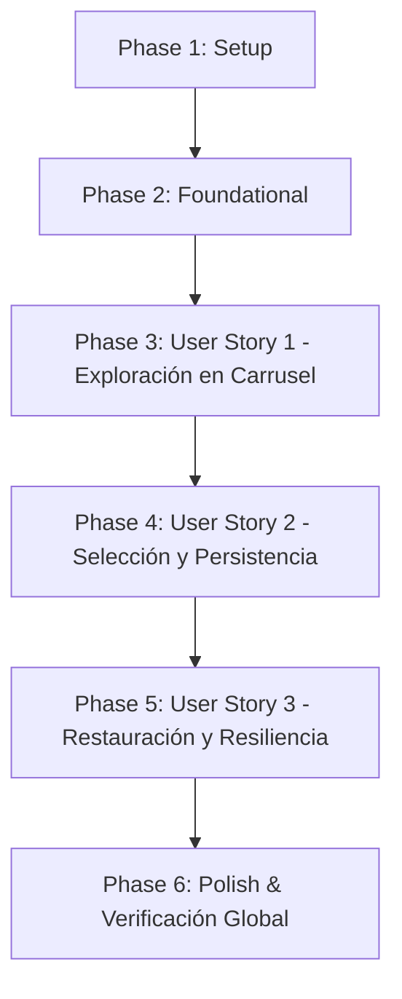

# Tasks: Selección de Imagen Alternativa para Recetas mediante Carrusel

**Feature**: `002-load-image`  
**Spec**: [spec.md](spec.md) | **Plan**: [plan.md](plan.md)  
**Status**: Implementation Completed  
**Created**: 2026-10-14  

---

## Phase 1: Setup (Shared Infrastructure)

**Purpose**: Estructuración inicial y estilos compartidos para el carrusel modal y las preferencias de imagen.

- [X] T001 [P] Crear interfaces base y modelos de dominio para candidatos de imagen y preferencias en `src/domain/models/recipe_image_candidate.ts` y `src/domain/models/recipe_image_preference.ts`
- [X] T002 [P] Configurar tokens de diseño y reglas CSS para el contenedor con CSS Scroll Snap y superposición modal en `src/presentation/styles/theme.css`

---

## Phase 2: Foundational (Blocking Prerequisites)

**Purpose**: Componentes indispensables del dominio, servicios de almacenamiento y proveedor de datos que bloquean la implementación de las historias de usuario.

**[CRITICAL]**: No debe iniciarse el desarrollo de ninguna historia de usuario hasta completar esta fase.

- [X] T003 [P] Implementar validadores y modelos tipados de dominio para `RecipeImageCandidate` y `RecipeImagePreference` en `src/domain/models/recipe_image_candidate.ts` y `src/domain/models/recipe_image_preference.ts`
- [X] T004 [P] Crear pruebas unitarias (TDD Mandatorio) para `RecipeImagePreferenceService` validando almacenamiento, consulta, eliminación y eventos de cambio en `src/tests/unit/recipe_image_preference_service.test.ts`
- [X] T005 Implementar servicio `RecipeImagePreferenceService` con persistencia en `localStorage` y emisión de eventos de sincronización en `src/domain/services/recipe_image_preference_service.ts`
- [X] T006 [P] Crear pruebas de contrato con MSW (TDD Mandatorio) para `fetchImageCandidatesByKeyword` simulando respuestas exitosas, respuestas vacías y errores de cuota o red en `src/tests/contract/image_candidates_provider.test.ts`
- [X] T007 Implementar método `fetchImageCandidatesByKeyword` en `ImageProviderClient` con biblioteca curada de múltiples imágenes por receta, consulta remota con `per_page=6` y respaldo vectorial SVG en `src/infrastructure/api/image_provider_client.ts`

**Checkpoint**: Base del dominio y adaptadores de datos completada. Las historias de usuario pueden comenzar a desarrollarse.

---

## Phase 3: User Story 1 - Exploración de Opciones Visuales en Carrusel Interactivo (Priority: P1) [MVP]

**Goal**: Permitir al usuario abrir un diálogo modal accesible con carrusel de imágenes alternativas gastronómicas haciendo clic sobre la imagen principal de la receta en la pantalla de detalle.

**Independent Test**: Abrir la ficha de detalle de cualquier receta existente, pulsar sobre la fotografía principal y verificar que se despliega el modal interactivo con el carrusel de alternativas y controles previo/siguiente funcionales.

### Tests for User Story 1 (TDD Mandatorio)

- [X] T008 [P] [US1] Crear pruebas de componentes para `RecipeImageCarouselModal` verificando renderizado, estados de carga y navegación en `src/tests/components/RecipeImageCarouselModal.test.tsx`

### Implementation for User Story 1

- [X] T009 [P] [US1] Implementar componente modal accesible `RecipeImageCarouselModal` con pista de desplazamiento CSS Scroll Snap, botones previo/siguiente, créditos de autoría y navegación por teclado en `src/presentation/components/RecipeImageCarouselModal.tsx`
- [X] T010 [US1] Conectar la apertura interactiva de `RecipeImageCarouselModal` al hacer clic en la fotografía principal de la receta en `src/presentation/components/RecipeDetail.tsx`

**Checkpoint**: En este punto, la Historia de Usuario 1 constituye el MVP funcional independiente, permitiendo explorar las opciones de imagen desde el detalle.

---

## Phase 4: User Story 2 - Selección y Persistencia de la Nueva Imagen de la Receta (Priority: P1)

**Goal**: Permitir al usuario seleccionar una imagen candidata del carrusel, actualizando la receta en tiempo real en la ficha de detalle, en las tarjetas del catálogo general y en el planificador semanal, persistiendo la selección en `localStorage`.

**Independent Test**: Seleccionar una imagen en el carrusel, verificar que el detalle refleja la nueva foto inmediatamente, navegar al catálogo para comprobar la tarjeta, y recargar la página para constatar la persistencia.

### Tests for User Story 2 (TDD Mandatorio)

- [X] T011 [P] [US2] Crear pruebas de integración para la selección de imagen, persistencia local y sincronización entre componentes en `src/tests/components/RecipeImageSelectionSync.test.tsx`

### Implementation for User Story 2

- [X] T012 [P] [US2] Implementar hook reactivo `useRecipeImagePreference` para resolver la imagen activa (preferencia personalizada o por defecto) con suscripción a eventos en `src/presentation/hooks/useRecipeImagePreference.ts`
- [X] T013 [US2] Conectar la acción de selección en `RecipeImageCarouselModal` para persistir la opción elegida mediante `RecipeImagePreferenceService` y cerrar el modal en `src/presentation/components/RecipeImageCarouselModal.tsx`
- [X] T014 [US2] Actualizar componente `RecipeCard` para utilizar `useRecipeImagePreference` y reflejar la imagen seleccionada en el catálogo general en `src/presentation/components/RecipeCard.tsx`
- [X] T015 [US2] Actualizar componentes `WeeklyPlanner` y `RecipeSelectModal` para mostrar la imagen personalizada activa en las ranuras del menú en `src/presentation/components/WeeklyPlanner.tsx` y `src/presentation/components/RecipeSelectModal.tsx`

**Checkpoint**: Historias de Usuario 1 y 2 completadas y sincronizadas reactivamente a través de toda la aplicación.

---

## Phase 5: User Story 3 - Cancelación, Restauración y Resiliencia ante Contingencias (Priority: P2)

**Goal**: Permitir cerrar el carrusel sin alterar la receta actual, ofrecer la opción de restablecer la imagen original por defecto y asegurar un comportamiento resiliente ante fallos de red o cuota.

**Independent Test**: Probar el cierre mediante Escape o clic exterior, restablecer la imagen por defecto con el botón correspondiente, y verificar que ante fallos de red se presentan opciones de respaldo sin romper la vista.

### Tests for User Story 3 (TDD Mandatorio)

- [X] T016 [P] [US3] Crear pruebas para la cancelación sin cambios y restauración de la imagen por defecto en `src/tests/components/RecipeImageCarouselActions.test.tsx`

### Implementation for User Story 3

- [X] T017 [US3] Implementar botón "Restablecer por defecto" y controladores de cierre por tecla Escape y clic exterior en `src/presentation/components/RecipeImageCarouselModal.tsx`
- [X] T018 [US3] Implementar interfaz de respaldo informativa cuando no existan imágenes remotas o ocurra un fallo de red, conservando la imagen previa intacta en `src/presentation/components/RecipeImageCarouselModal.tsx`

**Checkpoint**: Todas las historias de usuario están completamente implementadas y cubiertas por pruebas automatizadas.

---

## Phase 6: Polish & Cross-Cutting Concerns

**Purpose**: Verificación global de calidad, accesibilidad, diseño responsivo y auditoría de normas del proyecto.

- [X] T019 [P] Realizar auditoría de diseño responsivo y comportamiento táctil en dispositivos móviles desde 360px hasta escritorios 4K en `src/presentation/styles/theme.css`
- [X] T020 [P] Verificar criterios de accesibilidad WCAG (trampa de foco, atributos ARIA, contraste cromático y atajos de teclado) en `src/presentation/components/RecipeImageCarouselModal.tsx`
- [X] T021 Ejecutar escenarios de verificación manual de extremo a extremo conforme a `specs/002-load-image/quickstart.md`
- [X] T022 Ejecutar validación técnica global con pruebas automatizadas (`npm run test`), comprobación de tipos (`npm run typecheck`), build de producción (`npm run build`) y auditoría de cero emojis en el repositorio

---

## Dependencies & Execution Order

### Phase Dependencies

- **Setup (Phase 1)**: Inicialización sin dependencias previas.
- **Foundational (Phase 2)**: Depende de Phase 1. Bloquea todas las historias de usuario.
- **User Story 1 (Phase 3 - P1)**: Depende de Phase 2. Entrega el MVP de exploración visual.
- **User Story 2 (Phase 4 - P1)**: Depende de Phase 3 (US1) y Phase 2. Entrega la persistencia y sincronización reactiva.
- **User Story 3 (Phase 5 - P2)**: Depende de Phase 3 (US1) y Phase 4 (US2). Añade restauración y robustez ante contingencias.
- **Polish (Phase 6)**: Depende de la finalización de todas las historias de usuario.

### User Story Dependencies

### Parallel Opportunities

- **Fase 1**: T001 (modelos) y T002 (estilos CSS) en paralelo.
- **Fase 2**: T003 (modelos) y T004 (pruebas de servicio) en paralelo; T006 (pruebas de contrato) en paralelo con T005.
- **Fase 3**: T008 (pruebas de carrusel) y T009 (componente carrusel) en paralelo antes de la integración en T010.
- **Fase 4**: T011 (pruebas de sincronización) y T012 (hook) en paralelo; T014 y T015 en paralelo.
- **Fase 5**: T016 (pruebas de acciones) en paralelo con T017.
- **Fase 6**: T019 (responsividad) y T020 (accesibilidad) en paralelo.

---

## Implementation Strategy

### MVP First (User Story 1)

1. Completar Fase 1 (Setup) y Fase 2 (Foundational).
2. Desarrollar Fase 3 (User Story 1): el usuario ya puede abrir el carrusel modal desde el detalle y explorar imágenes alternativas.
3. Validar de forma autónoma el MVP antes de avanzar a la persistencia.

### Incremental Delivery

1. Foundation lista: modelos, servicio en memoria/local y contrato de candidatos con MSW.
2. Incremento 1 (MVP): Carrusel interactivo operable en la vista de detalle.
3. Incremento 2: Selección persistente y sincronización en catálogo y planificador.
4. Incremento 3: Restauración de imagen original por defecto y tolerancia a fallos.
5. Verificación final: Cobertura de pruebas al 100%, TypeScript estricto y cero emojis.
