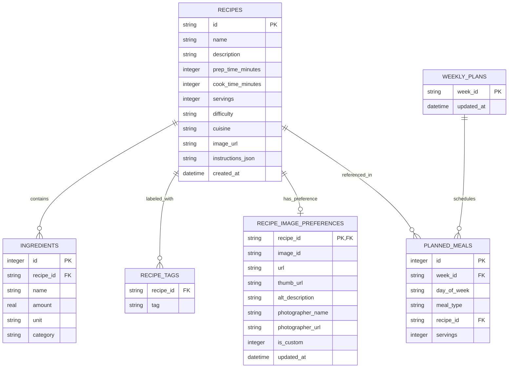

# Data Model & Persistence Architecture: Segregación Backend

**Feature**: `003-frontend-backend-segregation`  
**Date**: 2026-10-14  
**Status**: Completed Design (Phase 1)

---

## 1. Domain Entities & Database Relational Schema (SQLite)

El backend utiliza SQLite como motor de persistencia ACID embebido (`data/recipes.db`). La base de datos almacena el catálogo maestro de recetas, las preferencias de imagen personalizadas y los planes semanales.



---

## 2. Table Definitions (DDL)

```sql
CREATE TABLE IF NOT EXISTS recipes (
    id TEXT PRIMARY KEY,
    name TEXT NOT NULL,
    description TEXT NOT NULL,
    prep_time_minutes INTEGER NOT NULL,
    cook_time_minutes INTEGER NOT NULL,
    servings INTEGER NOT NULL,
    difficulty TEXT NOT NULL CHECK(difficulty IN ('Fácil', 'Intermedio', 'Avanzado')),
    cuisine TEXT NOT NULL,
    image_url TEXT NOT NULL,
    instructions_json TEXT NOT NULL,
    allergens_json TEXT NOT NULL DEFAULT '[]',
    created_at DATETIME DEFAULT CURRENT_TIMESTAMP
);

CREATE INDEX IF NOT EXISTS idx_recipes_name ON recipes(name);
CREATE INDEX IF NOT EXISTS idx_recipes_cook_time ON recipes(cook_time_minutes);

CREATE TABLE IF NOT EXISTS ingredients (
    id INTEGER PRIMARY KEY AUTOINCREMENT,
    recipe_id TEXT NOT NULL REFERENCES recipes(id) ON DELETE CASCADE,
    name TEXT NOT NULL,
    amount REAL NOT NULL,
    unit TEXT NOT NULL,
    category TEXT NOT NULL
);

CREATE INDEX IF NOT EXISTS idx_ingredients_recipe_id ON ingredients(recipe_id);

CREATE TABLE IF NOT EXISTS recipe_tags (
    recipe_id TEXT NOT NULL REFERENCES recipes(id) ON DELETE CASCADE,
    tag TEXT NOT NULL,
    PRIMARY KEY (recipe_id, tag)
);

CREATE TABLE IF NOT EXISTS recipe_image_preferences (
    recipe_id TEXT PRIMARY KEY REFERENCES recipes(id) ON DELETE CASCADE,
    image_id TEXT NOT NULL,
    url TEXT NOT NULL,
    thumb_url TEXT NOT NULL,
    alt_description TEXT NOT NULL,
    photographer_name TEXT NOT NULL,
    photographer_url TEXT,
    is_custom INTEGER NOT NULL DEFAULT 1,
    updated_at DATETIME NOT NULL
);

CREATE TABLE IF NOT EXISTS weekly_plans (
    week_id TEXT PRIMARY KEY,
    updated_at DATETIME NOT NULL
);

CREATE TABLE IF NOT EXISTS planned_meals (
    id INTEGER PRIMARY KEY AUTOINCREMENT,
    week_id TEXT NOT NULL REFERENCES weekly_plans(week_id) ON DELETE CASCADE,
    day_of_week TEXT NOT NULL CHECK(day_of_week IN ('lunes', 'martes', 'miercoles', 'jueves', 'viernes', 'sabado', 'domingo')),
    meal_type TEXT NOT NULL CHECK(meal_type IN ('lunch', 'dinner')),
    recipe_id TEXT NOT NULL REFERENCES recipes(id) ON DELETE CASCADE,
    servings INTEGER NOT NULL DEFAULT 2,
    UNIQUE(week_id, day_of_week, meal_type)
);
```

---

## 3. Migration & Seeding Lifecycle

- En el arranque del backend (`backend/database/sqlite.ts`), el servicio ejecuta automáticamente las migraciones DDL con `IF NOT EXISTS` y modo `PRAGMA foreign_keys = ON; PRAGMA journal_mode = WAL;`.
- Si la tabla `recipes` está vacía, se ejecuta un *seeder* inicial (`backend/database/seeds/recipes.seed.ts`) que importa el catálogo existente de recetas culinarias garantizando continuidad completa con la experiencia actual.
